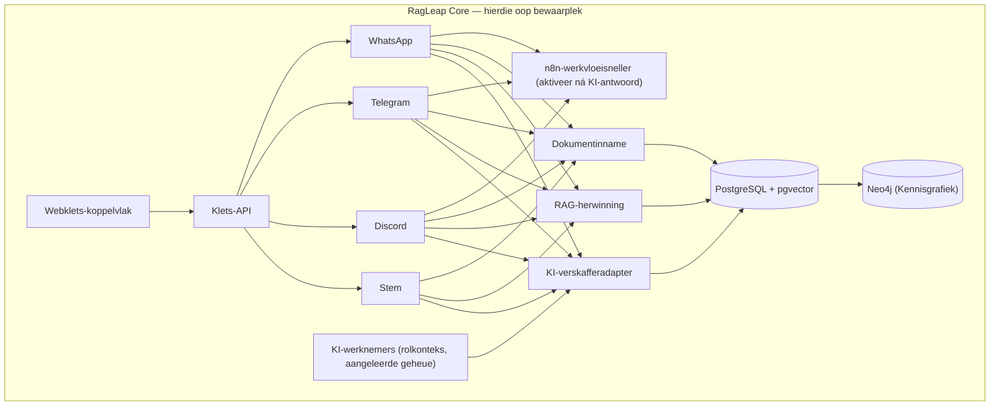
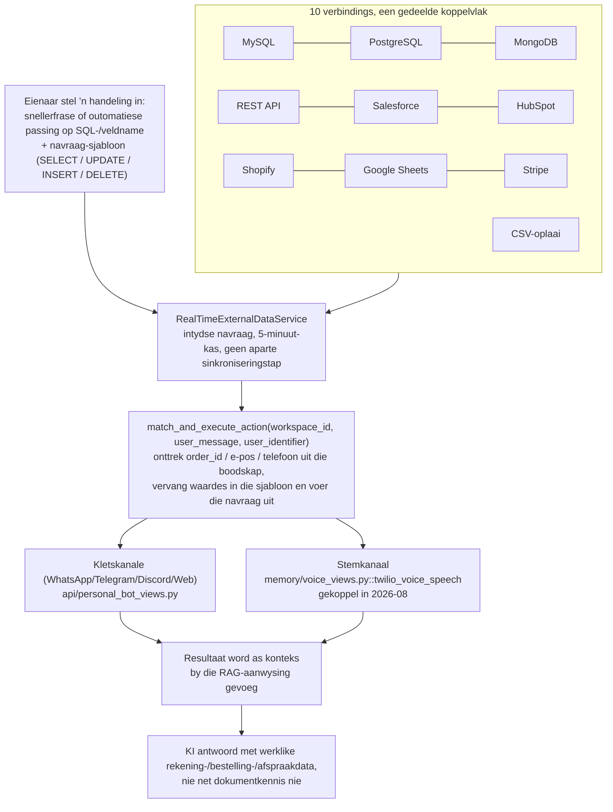

<div align="center">


# RagLeap Core

**Outonome KI-agente — Nie net RAG nie.**

[](../LICENSE) [](https://github.com/antonyrag/ragleap-core/releases) [](https://github.com/antonyrag/ragleap-core) [](https://github.com/antonyrag/ragleap-core) [](https://github.com/antonyrag/ragleap-core)
[](https://pypi.org/project/ragleap-rag/) [](https://pypi.org/project/ragleap-rag/)
[](https://pypi.org/project/ragleap-graph/) [](https://pypi.org/project/ragleap-graph/)
[](https://pypi.org/project/ragleap-vectorstores/) [](https://pypi.org/project/ragleap-vectorstores/)
[](https://pypi.org/project/ragleap-tools/) [](https://pypi.org/project/ragleap-tools/)
[](https://pypi.org/project/ragleap-ops/) [](https://pypi.org/project/ragleap-ops/)
[](https://pypi.org/project/ragleap-app-chart/) [](https://pypi.org/project/ragleap-app-chart/)
[](https://pypi.org/project/ragleap-observability/) [](https://pypi.org/project/ragleap-observability/)
[)](https://central.sonatype.com/artifact/io.github.antonyrag/ragleap-rag)
[](https://github.com/antonyrag/ragleap-core) [](https://discord.gg/mQwJuQDVrA) [](https://github.com/antonyrag/ragleap-core/pulse)

English · Afrikaans · [العربية](README.ar.md) · [Български](README.bg.md) · [বাংলা](README.bn.md) · [Català](README.ca.md) · [Čeština](README.cs.md) · [Cymraeg](README.cy.md) · [Dansk](README.da.md) · [Deutsch](README.de.md) · [Ελληνικά](README.el.md) · [Español](README.es.md) · [Eesti](README.et.md) · [فارسی](README.fa.md) · [Suomi](README.fi.md) · [Français](README.fr.md) · [ગુજરાતી](README.gu.md) · [עברית](README.he.md) · [हिन्दी](README.hi.md) · [Hrvatski](README.hr.md) · [Magyar](README.hu.md) · [Bahasa Indonesia](README.id.md) · [Italiano](README.it.md) · [日本語](README.ja.md) · [ಕನ್ನಡ](README.kn.md) · [한국어](README.ko.md) · [Lietuvių](README.lt.md) · [Latviešu](README.lv.md) · [Македонски](README.mk.md) · [മലയാളം](README.ml.md) · [मराठी](README.mr.md) · [नेपाली](README.ne.md) · [Nederlands](README.nl.md) · [Norsk](README.no.md) · [ਪੰਜਾਬੀ](README.pa.md) · [Polski](README.pl.md) · [Português](README.pt.md) · [Română](README.ro.md) · [Русский](README.ru.md) · [Slovenčina](README.sk.md) · [Slovenščina](README.sl.md) · [Soomaali](README.so.md) · [Shqip](README.sq.md) · [Svenska](README.sv.md) · [Kiswahili](README.sw.md) · [தமிழ்](README.ta.md) · [తెలుగు](README.te.md) · [ไทย](README.th.md) · [Tagalog](README.tl.md) · [Türkçe](README.tr.md) · [Українська](README.uk.md) · [اردو](README.ur.md) · [Tiếng Việt](README.vi.md) · [简体中文](README.zh-cn.md) · [繁體中文](README.zh-tw.md)

</div>

RagLeap Core is die oopbron-enjin agter RagLeap — ’n selfgehuisveste, agentiese stelsel wat jou besigheid met jou eie dokumente op jou eie bediener bestuur, sonder verskaffer-inperking.

**46 rolgebaseerde KI-werknemers:** 9 algemene kernrolle (KI-bestuurder, Sekretaris, HUB, Verkope, Ondersteuning, Menslike Hulpbronne, Finansies, Bemarking en Bedrywighede), plus 37 globale rolle wat op spesifieke bedryfsvertakkings fokus (werwer, eiendomsagent, regsake-inname, gesondheidsorg-inname, versekeringsagent en meer) — die volledige lys is in [`core/employees/defaults.py`](../core/employees/defaults.py).

**Wat dit doen:**
- Selflerende geheue wat uitkomste weeg
- Sneller werkvloeie en eskalasie outomaties
- Outonomiemodusse: `off` (verstek; die KI tree net op wanneer jy dit begin), `semi` (jy keur elke handeling goed) en `full` (opsioneel; sensitiewe rolle is nooit ten volle outonoom nie)
- ’n Dink-doen-besluit-siklus, nie bloot herwinning nie

[Vinnige begin](#quickstart) · [Dokumentasie](https://docs.ragleap.com) · [Webwerf](https://ragleap.com) · [Pakkette](https://packages.ragleap.com/)

---

> **Oopbron en selfgehuisves.** `ragleap-core` (hierdie bewaarplek) is onder die MIT-lisensie beskikbaar, heeltemal gratis en vereis nooit ’n lisensiesleutel nie. ’n Bestuurde wolkweergawe van RagLeap word beplan; vir eers is RagLeap slegs oopbron.

## Installasie

```bash
pip install ragleap-rag
```

> ⭐ As dit jou help, oorweeg dit asseblief om die bewaarplek ’n ster te gee — dit help werklik dat meer mense dit ontdek.

Verkies jy Java? `ragleap-rag` is ook op Maven Central beskikbaar:

```xml
<dependency>
    <groupId>io.github.antonyrag</groupId>
    <artifactId>ragleap-rag</artifactId>
    <version>0.5.0</version>
</dependency>
```

Die Java-pakket het ’n onafhanklike weergawenommer wat verskil van die Python-pakket hier bo — sien [`java/ragleap-rag`](../java/ragleap-rag) vir die huidige omvang.

Voeg ook `ragleap-graph` by as jy kennisgrafiek-herwinning met Neo4j wil gebruik:

```bash
pip install ragleap-rag ragleap-graph
```

Voeg ook `ragleap-vectorstores` by as jy inpropbare vektorrugkante wil hê buiten die ses wat in `ragleap-rag` ingebou is (tans Chroma):

```bash
pip install ragleap-rag ragleap-vectorstores[chroma]
# of, met uv
uv add ragleap-rag ragleap-vectorstores[chroma]
```

Voeg `ragleap-tools` by vir gereedgemaakte hulpmiddels vir LLM-gereedskapaanroepe (sakrekenaar, afgesandboksde lêerbewerkings, datum/tyd, eenheidsomskakeling, JSON/CSV-ontleding en teksnutsmiddels):

```bash
pip install ragleap-rag ragleap-tools
# of, met uv
uv add ragleap-rag ragleap-tools
```

Ontplooi jy na Kubernetes? `ragleap-ops` bevat manifeslêers wat in ’n werklike omgewing getoets is, plus ’n Helm-grafiek vir die volledige stapel:

```bash
pip install ragleap-ops
# of, met uv
uv add ragleap-ops
```

Het jy ’n algemene, herbruikbare grafiek vir jou eie toepassing nodig (nie spesifiek vir RagLeap nie)? `ragleap-app-chart` aanvaar ’n arbitrêre `services:`-lys, nie hardgekodeerde diensname nie:

```bash
pip install ragleap-app-chart
# of, met uv
uv add ragleap-app-chart
```

Wil jy statistieke en logs vir jou `ragleap-ops`-ontplooiing hê? `ragleap-observability` bevat Prometheus, Grafana, Loki + Promtail en AlertManager; die volledige integrasie is end-tot-end op ’n werklike cluster nagegaan:

```bash
pip install ragleap-observability
# of, met uv
uv add ragleap-observability
```

Of laat loop die volledige selfgehuisveste toepassing (kanale, webklets-koppelvlak en Docker Compose) — sien die [vinnige begin](#quickstart) hieronder. Blaai deur alle pakkette by [packages.ragleap.com](https://packages.ragleap.com). Probeer dit self met die uitvoerbare skrifte in [`examples/`](../examples/): `01_ingest_and_query.py` (laai ’n dokument op en stel ’n vraag via die API) en `02_test_channel_directly.py` (toets kanaal-antwoorde sonder werklike bot-aanmeldbesonderhede).

## As ’n RAG-kletsbot vrae beantwoord, bestuur RagLeap jou besigheid

Die meeste oopbron-RAG-projekte gee jou ’n gereedskapstel — jy moet steeds self die toepassing bou, ’n gebruikerskoppelvlak koppel, geheue byvoeg en elke kanaal integreer. RagLeap Core bied een KI oor WhatsApp, Telegram, Discord en stemoproepe, eerder as ’n aparte, ongekoppelde bot vir elke kanaal. Geheue bly tussen sessies en kanale behoue, sodat die stelsel nie elke keer van voor af moet leer wie ’n kliënt is nie. Stem is ’n werklike, werkende hanteerder vir inkomende oproepe (Twilio Media Streams, Whisper STT, OpenAI TTS) — nie bloot dokumentvrae-en-antwoorde met ’n telefoonnommer daaraan gekoppel nie — en n8n-werkvloei-outomatisering kan direk vanuit enige gesprek geaktiveer word.

Wat hierdie bewaarplek nié insluit nie: ’n administrasiepaneel vir verskeie huurders/kliënte (instellings, ontledings, span en fakturering) en ’n uitvoerende-assistentlaag (KI-bestuurder). RagLeap Core self is vir een huurder/ontplooiing bedoel, word self gehuisves en word via `.env` ingestel.

## Wat RagLeap Core spesifiek anders maak

Hierdie bewaarplek is nie ’n algemene RAG-raamwerk wat jy self aanmekaar moet sit nie — dit is ’n werklike, werkende enjin wat jy vandag kan laat loop. Die kode is eerlik daaroor dat die projek nog vroeg in sy ontwikkeling is.

## Waarom RagLeap bestaan

Oopbron-KI-agentprojekte soos OpenClaw het om ’n spesifieke rede gewild geword: mense wou ’n assistent hê wat op **hul eie infrastruktuur**, met **hul eie sleutels**, en in **die kletstoepassings wat hulle reeds gebruik** werk — nie ’n ondeursigtige stelsel wat deur iemand anders gehuisves word nie. RagLeap Core pas dieselfde beginsel spesifiek op besigheids-KI toe.

**Jou sleutels, jou infrastruktuur, jou data.** RagLeap Core vra nooit vir ’n stelsel-API-sleutel nie. Jy voorsien jou eie Gemini-sleutel, gebruik jou eie PostgreSQL-databasis, stoor jou dokumente op jou eie bediener, en stuur teks slegs na die KI-verskaffers wat jy instel (jou kletsmodel en Gemini vir inbeddings).

**Klets is die koppelvlak — nie ’n aparte paneel wat jy moet aanleer nie.** Net soos OpenClaw mense op WhatsApp, Telegram en Slack ontmoet, bereik RagLeap se volledige platform sake-eienaars op die kanale wat hulle reeds gebruik — WhatsApp, Telegram, Discord en werklike telefoonoproepe — nie via ’n nuwe toepassing wat hulle moet nagaan nie.

**’n Werklike, werkende stelsel — nie ’n abstrakte raamwerk nie.** Dit is nie ’n gereedskapstel soos LangChain waar jy jou eie toepassing uit basiese boublokke saamstel nie. RagLeap Core is die werklike proses vir segmentering → inbedding → herwinning → generering, onttrek uit ’n produksiestelsel wat reeds werklike kliëntvrae beantwoord by ’n onderneming wat daarop staatmaak.

**Oop en eerlik ontwikkel.** Hierdie bewaarplek sê duidelik wat klaar is en wat nie. Geen opgeblase aansprake of Quickstart-opdragte vir funksies wat nog nie werk nie — die padkaart weerspieël die werklike toestand van die kode en word opgedateer namate dit vorder.

## Wat RagLeap Core is

RagLeap Core is ’n klets-enjin wat op dokumente gegrond is. Laai jou dokumente op, stel vrae en kry antwoorde met bronverwysings — self gehuisves, op jou eie infrastruktuur, met jou eie API-sleutel.

WhatsApp-, Telegram- en Discord-bots is ook in hierdie bewaarplek ingesluit — kanaaladapters vir een ontplooiing, ingestel via `.env`, wat antwoorde uit dieselfde dokumentkennisbasis gee.

## RagLeap Core is geskik vir jou as

- ✅ Jy ’n selfgehuisveste RAG-kletsbot wil hê met volle beheer oor jou data
- ✅ Jy presies wil verstaan hoe dokumentherwinning en bronverwysings werk, eerder as om ’n ondeursigtige stelsel te gebruik
- ✅ Jy gemaklik is daarmee om jou eie bediener en KI-verskaffersleutel te bestuur
- ✅ Jy wil bydra tot ’n oop enjin vir dokumentvrae-en-antwoorde of dit uitbrei
- ✅ Jy eerder die kode wil sien as om ’n verskaffer se woord oor dataprivaatheid te vertrou

## Wat RagLeap Core nié is nie

| Dit is nie... | Dit is... |
|---|---|
| ’n Gehuisveste produk | Selfgehuisveste sagteware wat jy self laat loop |
| ’n Stelsel vir verskeie huurders met geheue wat tussen sessies behoue bly | Een ontplooiing vir een huurder — een bot en een dokumentstel |
| ’n Veelhuurder-platform | WhatsApp-/Telegram-/Discord-/stemkanaaladapters is ingesluit, vir een huurder |
| ’n Geen-kode-SaaS-paneel | ’n Kodebasis wat jy self ontplooi en instel |
| ’n Volledig afgewerkte produk | Die grondslagfunksies — sien die [padkaart](#roadmap) |

## Kenmerke

| | |
|---|---|
| 📄 **Dokumentinname** | Laai PDF's, teks en algemene dokumentformate op |
| 🔍 **RAG-herwinning** | Vektorsoektog oor jou dokumente via pgvector |
| 💬 **Klets met bronverwysings** | Antwoorde verwys na die brondokument, nie na ’n ondeursigtige stelsel nie |
| 🔌 **Gebruik jou eie KI-sleutel** | OpenAI, Gemini, Anthropic of enige OpenAI-versoenbare eindpunt |
| 🌐 **Webkletslegstuk** | Voeg ’n kletslegstuk by enige webwerf in |
| 🐳 **Docker-gebaseerde opstelling** | Plaaslike ontplooiing met een opdrag |
| 🕸️ **Kennisgrafiek (Neo4j)** | Entiteitsonttrekking en grafiekversterkte herwinning saam met vektorsoektog |
| 🌍 **Taalherkenning** | Herken dokument- en navraagtale outomaties; geld oor alle kanale |
| 🔗 **Integrasies** | Koppel MySQL, PostgreSQL, MongoDB, REST-API's, Salesforce, HubSpot, Shopify, Google Sheets en Stripe |
| 🔀 **Hibriede soektog** | Kombineer digte (vektor-) en yl (volteks-)herwinning met Reciprocal Rank Fusion |
| ⚡ **Stroomantwoorde** | Antwoorde word token vir token gestroom, eerder as om vir die volledige antwoord te wag |
| 🔁 **Verskaffer-terugval** | Probeer outomaties ’n rugsteun-LLM-verskaffer as die primêre een misluk |
| 💰 **Tokengebruikverslagdoening** | Werklike tokengetalle per oproep vanaf die verskaffer, plus beperking van die kontekste-begroting |
| 🧑‍💼 **KI-werknemers** | Rolgebaseerde agente (46 verstekrolle) met volgehoue besigheidskonteksgeheue, beskikbaar in `/chat` via `role=<role>` |
| 🛠️ **Bou jou eie KI-werknemer** | Definieer ’n pasgemaakte rol (enige naam, persoonlikheid, kanale en vaardigheidmerkers) via `PATCH /employees/{role}` — geen fork of kodeverandering nodig nie. Regstreeks geverifieer: ’n nuwe rol is end-tot-end geskep, opgespoor en gelys. |
| 🔗 **n8n-werkvloei-outomatisering** | Stuur ’n webhook nadat die KI op WhatsApp/Telegram/Discord antwoord — geenkode-outomatisering wat direk uit ’n gesprek geaktiveer word nie |

## Argitektuur

Só is RagLeap Core saamgestel:



**Opsionele agtergrondwerkry.** Die periodieke integrasiesinkroniseringstaak loop by verstek binne die API-proses. As jy `REDIS_URL` instel, gebruik dit eerder ’n werklike Redis-werkry (RQ), wat deur afsonderlike `worker`-prosesse verwerk word en onafhanklik kan skaal — horisontaal via `docker compose up -d --scale worker=N`, of in Kubernetes met ’n outoskaalder volgens werkrydiepte soos KEDA (sien `examples/keda-scaledobject-worker.yaml` vir ’n voorbeeld-`ScaledObject`). Dit is heeltemal opsioneel; niks verander as `REDIS_URL` nie ingestel is nie.

### Bewaarplekstruktuur

```
ragleap-core/
├── core/                  # RAG-enjin — segmentering, inbedding, herwinning, generering
│   ├── chunker.py
│   ├── embedding.py       # Gemini-inbeddings (gemini-embedding-001, 3072 dimensies)
│   ├── retrieval.py       # pgvector-kosinusherwinning
│   ├── generation.py      # BYOK-generering met 19 verskaffers (Gemini, OpenAI, Anthropic, ens.)
│   ├── ingest.py          # segment -> inbed -> stoor-proses
│   ├── parsers.py         # PDF/DOCX/TXT-teksonttrekking
│   ├── employees/         # KI-werknemers — rolle, besigheidsprofiel, aangeleerde geheue
│   ├── workflows.py       # n8n-werkvloei-outomatisering — webhook-snellers
│   └── api.py             # FastAPI-toepassing — /health, /upload, /chat, /profile, /employees, /n8n-workflows, /webhook/*
├── channels/              # Boodskap- en stemkanaaladapters
│   ├── whatsapp/          # Twilio + Gupshup
│   ├── telegram/
│   ├── discord/
│   └── voice/             # Twilio Media Streams, WebSocket-bediener
├── db/
│   └── schema.sql         # documents- en chunks-tabelle, pgvector-indeks
├── examples/              # Uitvoerbare voorbeelde
├── .github/workflows/     # CI: samestellingskontrole, Docker-bou, rooktoetse
├── docker-compose.yml     # app + databasis + stemdienste
└── Dockerfile
```

## Vinnige begin

> ✅ **Status: kernpyplyn se werking is geverifieer.** Inname -> inbedding -> herwinning -> generering werk end-to-end via Docker Compose, insluitend ’n toets met ’n vars kloon. Sien die [padkaart](#roadmap) vir volgende stappe (PDF/DOCX-ondersteuning en alternatiewe BYOK-verskaffers).

**Die vinnigste manier om dit te probeer** — een opdrag kontroleer Docker, kloon die bewaarplek en stel `.env` vir jou op:

```bash
curl -fsSL https://raw.githubusercontent.com/antonyrag/ragleap-core/main/install.sh | bash
```

(Windows-gebruikers: voer dit in Git Bash uit, nie in Command Prompt of PowerShell nie.)

Die skrif sal ná die kloon wag en jou vra om jou Gemini-API-sleutel by `.env` te voeg — kry ’n gratis sleutel by [aistudio.google.com/apikey](https://aistudio.google.com/apikey) en voer dan dieselfde opdrag weer uit.

**Of gebruik die handmatige metode** — beter as jy die kode wil lees voordat jy iets laat loop:

```bash
git clone https://github.com/antonyrag/ragleap-core.git
cd ragleap-core
cp .env.example .env
# voeg jou Gemini-API-sleutel by .env
docker compose up --build -d
```

Vereistes: Docker, Docker Compose en ’n Gemini-API-sleutel (inbeddings gebruik tans altyd Gemini). Vir klets kan jy Gemini of enige van die 19 verskaffers onder [Ondersteunde LLM-verskaffers](#supported-llm-providers-byok) gebruik, insluitend ’n plaaslike Ollama-model en enige OpenAI-versoenbare eindpunt.

**Probeer dit binne 30 sekondes** — wanneer die stapel loop, sien [`examples/`](../examples/) vir twee geverifieerde, uitvoerbare skrifte:
- `examples/01_ingest_and_query.py` — laai ’n dokument op en stel ’n vraag via die API
- `examples/02_test_channel_directly.py` — toets WhatsApp-/Telegram-/Discord-antwoordlogika sonder werklike bot-aanmeldbesonderhede

## Wil jy net die RAG-enjin as ’n Python-biblioteek hê?

As jy nie die volledige Docker-toepassing nodig het nie — WhatsApp-/Telegram-/Discord-/stemadapters, die webklets-koppelvlak en alles daarby — is die kernherwinningsenjin ook as selfstandige, met pip installeerbare Python-pakkette beskikbaar:

```bash
pip install ragleap-rag
```

- **`ragleap-rag`** — die segmentering → inbedding → herwinning → generering-pyplyn as ’n biblioteek. Inpropbare inbeddings (8 verskaffers: Gemini, OpenAI, Mistral, Together, Ollama, Cohere, Voyage en ’n pasgemaakte eindpunt), 6 vektorrugkante (FAISS, PgVector, Pinecone, Weaviate, Qdrant, Milvus), kruiskodeerder-herordening en meer.
- **`ragleap-graph`** — kennisgrafiek-herwinning met Neo4j; kan alleen of saam met `ragleap-rag` gebruik word.
- **`ragleap-vectorstores`** — inpropbare vektorrugkante buiten die 6 in `ragleap-rag` se kern. Rugkante: Chroma en LanceDB (ingebed/plaaslik), Redis (RediSearch/Redis Stack), Upstash Vector (bestuurde bedienerlose diens) en OpenSearch (k-NN). Installeer met `pip install ragleap-vectorstores[chroma]` of `uv add ragleap-vectorstores[chroma]`.
- **`ragleap-tools`** — selfstandige nutsmiddels met min afhanklikhede vir LLM-gereedskapaanroepe. 12 staatlose nutsmiddels (sakrekenaar, datum/tyd, eenheidsomskakeling, JSON/CSV-ontleding en teksnutsmiddels), afgesandboksde lêerbewerkings (beskerm teen ontsnapping via simboliese skakels), `search_documents` (hibriede vektor- en sleutelwoordsoektog), `search_web` (inpropbare BYOK-verskaffers soos Tavily en Serper), en opsionele dokumentinname deur `ragleap-rag`. Dit beheer nie ’n uitvoeringslus vir gereedskapaanroepe nie — dit bied `Tool`-objekte vir jou eie lus of vir `ragleap-agents` wanneer dit beskikbaar kom. Installeer met `pip install ragleap-tools` of `uv add ragleap-tools`.
- **`ragleap-ops`** — Kubernetes-ontplooiingsmanifeste vir RagLeap Core, end-to-end op ’n werklike cluster getoets. Installeer met `pip install ragleap-ops` of `uv add ragleap-ops`.
- **`ragleap-app-chart`** — algemene, herbruikbare Helm-grafiek om arbitrêre dienste na Kubernetes te ontplooi; nie RagLeap-spesifiek nie. Verwys na jou eie toepassing met ’n `services:`-lys. Installeer met `pip install ragleap-app-chart` of `uv add ragleap-app-chart`.
- **`ragleap-observability`** — Prometheus, Grafana, Loki + Promtail vir `ragleap-ops`, end-to-end op ’n werklike cluster geverifieer (werklike verbinding bevestig, werklike nie-nul statistieke ontvang; 21+ werklike logstrome met korrekte naamruimte-/pod-/houeretikette). AlertManager is aan Prometheus gekoppel met ’n eerste werklike waarskuwingsreël, plus opsionele Slack-/e-posontvangers (by verstek af; aflewering is met ’n plaasvervanger geverifieer, maar werklike versending is nog nie bevestig nie). Installeer met `pip install ragleap-observability` of `uv add ragleap-observability`.
- **`ragleap-terraform`** — Terraform-module wat ’n plaaslike kind-cluster skep en RagLeap Helm-grafieke installeer; dit is op ’n werklike cluster toegepas en weer verwyder (nog geen wolkmodules nie). Installeer met `pip install ragleap-terraform` of `uv add ragleap-terraform`.

Al agt pakkette is onder die MIT-lisensie beskikbaar. Blaai deur die volledige pakketindeks by [packages.ragleap.com](https://packages.ragleap.com).

## Ondersteunde LLM-verskaffers (BYOK)

RagLeap Core gebruik uitsluitlik jou eie sleutels (bring-your-own-key); geen verskaffer se sleutel word deur die stelsel verskaf nie. Stel `LLM_PROVIDER` in `.env` om die verskaffer vir die genereringstap (klets) te kies. Inbeddings gebruik tans altyd Gemini (`gemini-embedding-001`), ongeag `LLM_PROVIDER`.

| `LLM_PROVIDER`-waarde | Vereiste omgewingsveranderlikes | Notas |
|---|---|---|
| `gemini` (verstek) | `GEMINI_API_KEY` | Kry ’n sleutel by aistudio.google.com/apikey |
| `anthropic` | `ANTHROPIC_API_KEY`, `ANTHROPIC_MODEL` (opsioneel) | Kry ’n sleutel by console.anthropic.com |
| `openai` | `OPENAI_API_KEY`, `OPENAI_MODEL` | |
| `mistral` | `MISTRAL_API_KEY`, `MISTRAL_MODEL` | |
| `groq` | `GROQ_API_KEY`, `GROQ_MODEL` | Gratis vlak beskikbaar |
| `together` | `TOGETHER_API_KEY`, `TOGETHER_MODEL` | |
| `openrouter` | `OPENROUTER_API_KEY`, `OPENROUTER_MODEL` | |
| `ollama` | `OLLAMA_MODEL` (geen API-sleutel nodig nie) | Selfgehuisves; Ollama moet plaaslik loop |
| `deepseek` | `DEEPSEEK_API_KEY`, `DEEPSEEK_MODEL` | |
| `xai` | `XAI_API_KEY`, `XAI_MODEL` | |
| `cohere` | `COHERE_API_KEY`, `COHERE_MODEL` | |
| `perplexity` | `PERPLEXITY_API_KEY`, `PERPLEXITY_MODEL` | |
| `qwen` | `QWEN_API_KEY`, `QWEN_MODEL` | |
| `moonshot` | `MOONSHOT_API_KEY`, `MOONSHOT_MODEL` | |
| `zhipu` | `ZHIPU_API_KEY`, `ZHIPU_MODEL` | |
| `yi` | `YI_API_KEY`, `YI_MODEL` | |
| `baidu` | `BAIDU_API_KEY`, `BAIDU_MODEL` | |
| `minimax` | `MINIMAX_API_KEY`, `MINIMAX_MODEL` | |
| `custom` | `CUSTOM_API_KEY`, `CUSTOM_MODEL`, `CUSTOM_BASE_URL` | Enige OpenAI-versoenbare eindpunt |

Voorbeeld: skakel in `.env` oor na Groq:

```
LLM_PROVIDER=groq
GROQ_API_KEY=your-groq-key
GROQ_MODEL=llama-3.3-70b-versatile
```

### Ollama in Docker: bekende probleme

Om Ollama as ’n plaaslike of terugvalverskaffer binne hierdie toepassing se Docker-houer te laat loop (eerder as direk op die gasheer), vereis werklik geverifieerde stappe buiten bloot die instelling van `OLLAMA_MODEL`:

1. **`host.docker.internal` is nie betroubaar op gewone Linux Docker Engine nie** (anders as Docker Desktop) — dit kan na die verkeerde brugnetwerk se gateway verwys. As Ollama-verbindings met hierdie alias misluk, stel `OLLAMA_BASE_URL` direk op die werklike gateway-IP van die Compose-netwerk in, byvoorbeeld `OLLAMA_BASE_URL=http://172.18.0.1:11434/v1` (vind jou gateway met `docker network inspect <network> | grep Gateway`).
2. **Ollama bind by verstek aan `127.0.0.1`**, wat ’n houer nie kan bereik nie, selfs met die korrekte gateway-IP. Stel dit om op alle koppelvlakke te luister:

```bash
   mkdir -p /etc/systemd/system/ollama.service.d
   cat > /etc/systemd/system/ollama.service.d/override.conf << 'EOF'
   [Service]
   Environment="OLLAMA_HOST=0.0.0.0:11434"
   EOF
   systemctl daemon-reload && systemctl restart ollama
```

3. **Die gasheermuurbrandmuur kan houer-na-gasheer-verkeer stilweg laat val** selfs ná bogenoemde — verkeer van die houer na die bruggateway gaan deur ufw se `INPUT`-ketting, nie `FORWARD`/`DOCKER-USER` nie. Laat dit uitdruklik toe: `ufw allow from 172.18.0.0/16 to any port 11434 proto tcp` (pas die subnet by jou werklike Docker-netwerk aan).

## Stemkanaal (Twilio)

RagLeap Core bevat ’n intydse stemkanaal: Twilio Media Streams koppel via WebSocket; jou spraak word met OpenAI Whisper getranskribeer, deur die kern-RAG-pyplyn beantwoord en met OpenAI TTS teruggespreek. Die stemaktiwiteitsopsporing en eggo-onderdrukking kom uit ’n produksiestelsel wat op werklike oproepverkeer ingestel is.

Dit loop as ’n afsonderlike diens op poort 8765 (sien `docker-compose.yml`), omdat Twilio se intydse oudioprotokol ’n rou WebSocket-bediener benodig, nie ’n HTTP-roete nie.

**Opstelling:**
1. Stel `OPENAI_API_KEY` in `.env` in (in v1 vir beide Whisper STT en TTS gebruik).
2. Stel opsioneel `VOICE_BOT_NAME`, `VOICE_GREETING` en `VOICE_TTS_VOICE` in.
3. Verwys die `<Connect><Stream>`-TwiML van ’n Twilio-telefoonnommer na `wss://your-domain.com:8765`.

**Eerlike status:** Die WebSocket-bediener, Twilio-gebeurtenisprotokolhantering en foutafhandeling is geverifieer. Die volledige Whisper/TTS-rondrit is nog nie end-to-end in ’n regstreekse omgewing getoets nie (dit vereis OpenAI-API-krediete). As jy dit probeer en probleme ondervind, maak asseblief ’n issue oop — hierdie projek het juis hierdie soort werklike toetsing nodig.

**Bekende beperkings wat uit produksie oorgekom het en nog nie hier reggestel is nie:**
- In v1 word net OpenAI Whisper (STT) en OpenAI TTS ondersteun — Deepgram en ElevenLabs (meertalige ondersteuning) is goeie eerste-issue-kandidate.
- Nie-Engelse TTS-gehalte wissel omdat OpenAI se TTS-stemme vir Engels ingestel is.
- Die tipiese rondritvertraging in produksie was 6–8 sekondes.

## Kennisgrafiek (Neo4j)

RagLeap Core bou ’n liggewig-grafiek van entiteite wat saam voorkom, langs sy vektorindeks. Wanneer jy ’n dokument inneem, word entiteite (produkname, akronieme en eiename) onttrek en in Neo4j gekoppel. Wanneer jy ’n vraag stel, word dieselfde onttrekking op jou navraag uitgevoer; dokumente wat aan ooreenstemmende entiteite gekoppel is, kry ’n soortgelykheidsverhoging tydens herwinning — bo en behalwe, nie in plaas van nie, gewone pgvector-soektog.

Dit loop as die vierde Docker Compose-diens op poorte `7475`/`7688` (herkarteer vanaf Neo4j se verstekpoorte om botsing met ’n ander Neo4j-instansie op dieselfde gasheer te vermy). As Neo4j onbereikbaar is of `NEO4J_PASSWORD` nie ingestel is nie, degradeer die grafiek netjies — herwinning val terug na suiwer vektorsoektog en dokumentinname word nie geraak nie.

**Opstelling:**
1. Stel `NEO4J_URI`, `NEO4J_USER` en `NEO4J_PASSWORD` in `.env` in (dit moet ooreenstem met die `NEO4J_AUTH`-waarde in `docker-compose.yml`).
2. Stel opsioneel `DOMAIN_TERMS` in — ’n komma-geskeide lys domeinspesifieke terme wat tydens onttrekking versterk moet word (byvoorbeeld `DOMAIN_TERMS=API,SDK,RAG`).

**Eerlike status:** Entiteitsonttrekking, skryf van dokumentgrafieke, entiteitsgebaseerde dokumentopsoek en grafiekversterkte kletsherwinning is end-to-end geverifieer, ook in CI (vars bou, werklike inname, werklike navraag en werklike grafiekopsoek). Die grafiekversterking is tans ’n eenvoudige byvoeging tot die telling, nie ’n volledige geweegde herordener nie — ’n ryker hibriede rangordestelsel is ’n goeie volgende stap vir bydraers.

**Bekende beperkings:**
- Entiteitsonttrekking is op regex gebaseer (CamelCase, akronieme, hoofletterfrases en opsionele domeinterme) — dit is nie ’n opgeleide NER-model nie; sommige entiteite sal gemis word en soms sal geraas ingesluit word.
- `search_related_entities()` (grafiekdeurloop oor verskeie spronge) is geïmplementeer, maar nog nie aan die herwinningspyplyn gekoppel nie — ’n goeie eerste issue vir iemand wat wil bydra.

## Taalherkenning

RagLeap Core herken die taal outomaties tydens dokumentinname (per segment) en tydens klets (per navraag), met die `langdetect`-biblioteek plus skrifgebaseerde heuristieke vir CJK-, Hangul- en Kana-teks. Omdat elke kanaal (WhatsApp, Telegram, Discord, Stem en die API direk) deur dieselfde kernkletspyplyn loop, werk herkenning oral konsekwent sonder kanaalspesifieke bedrading.

**Opstelling:** Werk sonder enige konfigurasie. Jy kan opsioneel `DEFAULT_LANGUAGE` stel (terugval wanneer herkenning misluk of teks te kort is), `LANGUAGE_DETECTION_CONFIDENCE_THRESHOLD` (verstek `0.7`) en `LANGUAGE_DETECTION_SUPPORTED_LANGUAGES` (komma-geskeide toelatingslys; leeg = geen beperking).

**Eerlike status:** End-to-end geverifieer — dokumentvlak-herkenning is met hoë vertroue (0.9999) op ’n werklike gemengdetaaldokument getoets, en navraagvlak-herkenning is via beide die API en CLI bevestig.

**Bekende beperkings:**
- `langdetect` dek ongeveer 55 tale — aansienlik minder as die 222+ van die gehuisveste platform, wat addisionele herkenning en taalvoorkeure per gebruiker byvoeg.
- Kort navrae in tale wat sterk op mekaar lyk, kan verkeerd herken word (in toetsing is ’n kort Franse navraag as Italiaans herken). Dit is ’n inherente beperking van statistiese herkenning op kort teks, nie iets uniek aan hierdie poort nie. Dit is ’n goeie eerste issue vir iemand wat kortnavraag-akkuraatheid wil verbeter.
- Herkenning werk net in een rigting: RagLeap Core herken en wys die navraag se taal, maar stuur die KI se antwoordtaal nog nie om daarmee ooreen te stem nie — dit is ’n redelike volgende stap vir ’n bydraer.

## Integrasies



**Regstreeks geverifieer** deur `RealTimeExternalDataService` in `api/addon_realtime.py` te lees. Twee dinge moet duidelik gestel word: `match_and_execute_action` ondersteun werklik skryfnavrae (`UPDATE`/`INSERT`/`DELETE`), nie net leesnavrae nie. Die eienaar stel dit in; die veiligheidsgrens is dus die SQL wat die eienaar in die sjabloon skryf, nie ’n beperking wat die raamwerk self afdwing nie. Tot 2026-08 het hierdie aksiepassing net op kletskanale geloop; stemoproepe het nie ’n ekwivalent gehad nie. Die gaping is toe deur die stemkanaalroeteringsdiagram hier bo toegemaak.

RagLeap Core koppel aan eksterne databasisse en besigheidshulpmiddels en sinkroniseer konteks per gebruiker om RAG-antwoorde te personaliseer. Nege verbindings is ingesluit: MySQL, PostgreSQL, MongoDB, algemene REST-API's, Salesforce, HubSpot, Shopify, Google Sheets en Stripe.

Elke CRM-/SaaS-verbinding gebruik aanmeldbesonderhede wat jy direk verskaf — ’n gebruikersnaam/wagwoord, private-toepassingstoken, administrateur-API-token, diensrekening-JSON-lêer of geheime sleutel, na gelang van die diens. Geen verbinding vereis dat jy ’n OAuth-toepassing registreer nie; niks hier hang daarvan af dat RagLeap ’n derdeparty-ontwikkelaarrekening besit nie.

Aanmeldbesonderhede word met rus geënkripteer (Fernet/AES-128) voordat dit gestoor word.

**Opstelling:**
1. Genereer ’n enkripsiesleutel: `python3 -c "from cryptography.fernet import Fernet; print(Fernet.generate_key().decode())"`
2. Stel `ADDON_ENCRYPTION_KEY` in `.env` op daardie waarde.
3. Installeer die SDK vir die verbindings wat jy wil gebruik (elkeen is opsioneel; sien `requirements.txt`).
4. Skep ’n databron: `POST /integrations` met `name`, `source_type` en die relevante aanmeldvelde.
5. Toets dit: `POST /integrations/{id}/test`.
6. Sinkroniseer dit: `POST /integrations/{id}/sync`.

**Eerlike status:** End-to-end teen ’n werklike openbare API geverifieer — verbindingstoetsing, sinkronisering, korrekte passing van identifiseerdervelde en enkripsie van aanmeldbesonderhede (as werklike syferteks in die databasis nagegaan, nie bloot aanvaar nie) is alles bevestig.

**Bekende beperkings:**
- 9 van die 18 brontipes wat in die gehuisveste platform se koppelvlak gelys word, het hier werklike verbindings. CSV-oplaai, Snowflake, BigQuery, WooCommerce, Airtable, Notion, Razorpay, Slack en Gmail is goeie eerste-issue-kandidate.
- Sinkronisering is slegs op aanvraag (`POST /integrations/{id}/sync`) — daar is nog geen geskeduleerde agtergrondsinkronisering nie, hoewel die skema `sync_interval_minutes` vir ’n toekomstige Celery-beat-ekwivalent bevat.
- Gesinkroniseerde konteks word nog nie outomaties by kletsantwoorde gevoeg nie — elke kanaaladapter sal eers die gebruiker se identifiseerder moet ken; dit is ’n redelike volgende bydrae.

## Herwinning, generering en betroubaarheid

Benewens die kern-RAG-pyplyn ondersteun `/chat` (en die onderliggende `core.chat.ask()`) verskeie beheermaatreëls vir produksiegebruik: herwinningsgehalte, antwoordvertraging, verskafferbetroubaarheid en koste.

**Hibriede soektog (dig + yl).** Herwinning kombineer by verstek pgvector-kosinusooreenkoms met PostgreSQL-voltekssoektog (`tsvector`/`GIN`-indeks), saamgevoeg via Reciprocal Rank Fusion. Dit vind semantiese passings én presiese sleutelwoord-/identifiseerderpassings wat ’n suiwer inbeddingssoektog kan mis. Gee `hybrid=false` om slegs digte herwinning te gebruik (goedkoper — een navraag eerder as twee).

**Stroomverwerking.** `POST /chat/stream` stroom die antwoord terwyl dit gegenereer word (`text/plain`, stukgewyse oordrag), eerder as om vir die volledige antwoord te wag. Dit is inheems per verskaffer geïmplementeer (Gemini, Anthropic en OpenAI-versoenbare verskaffers het verskillende stroom-API's — al drie werk werklik; nie een is ’n leë stub nie).

**Verskaffer-terugval.** Stel `LLM_FALLBACK_PROVIDERS` (komma-geskeide lys) in om outomaties weer met rugsteunverskaffers te probeer as die primêre een misluk. ’n Tarieflimiet, diensonderbreking of verkeerde sleutel by die primêre verskaffer hoef nie ’n mislukte versoek te beteken nie. Elke terugvalverskaffer moet sy eie API-sleutel hê wat soos gewoonlik ingestel is. Stroomverwerking kan net terugval *voordat* enige teks aan die oproeper gestuur is — ’n fout in die middel van ’n stroom word as ’n fout aangedui, eerder as om stilweg van verskaffer te verander en die uitvoer verwarrend te maak.

**Genereringsbeheer.** `temperature`, `system_prompt` en `max_tokens` is werklike parameters per oproep (nie net verstekwaardes uit omgewingsveranderlikes nie). Bou jou eie agentgedrag bo-op RagLeap se herwinning sonder om die biblioteek te fork.

**Tokengebruik en konteksbegroting.** Elke blokkerende `/chat`-oproep gee werklike tokengebruik terug (`prompt_tokens`, `completion_tokens`, `total_tokens`) wat direk uit die verskaffer se antwoord verkry word — nie ’n skatting nie. Herwonne konteks word ook tot `MAX_CONTEXT_CHARS` beperk (verstek 12000; ongeveer 4 karakters per token vir Engelse teks) voordat dit gestuur word. Die laagste gerangskikte segmente word eerste verwyder, sodat jy nie vir meer konteks betaal as wat nodig is nie. Stel `MAX_CONTEXT_CHARS=0` om hierdie beperking af te skakel.

**Eerlike status:** Die RRF-samesmeltingsberekening vir hibriede soektog is met handberekening geverifieer. Stroomverwerking werk end-to-end vir die verstekverskaffer. Terugval is met ’n werklike foutiewe primêre verskaffer getoets — ’n doelbewus ongeldige API-sleutel het die stelsel na ’n werkende sekondêre verskaffer laat oorskakel, wat ’n korrekte antwoord gelewer het. Tokengebruik en konteksbeperking is met werklike syfers geverifieer: ’n herwinning van 3 segmente wat onder ’n streng begroting tot 1 segment beperk is, het die werklike `prompt_tokens` met 38% verminder op dieselfde regstreekse API.

**Bekende beperkings:**
- Tokengebruikverslagdoening is nie vir stroomantwoorde beskikbaar nie — elke verskaffer se stroom-API stel gebruiksinligting anders beskikbaar; om al drie korrek te ondersteun, is afsonderlike werk wat nog nie gedoen is nie.
- `MAX_CONTEXT_CHARS` is ’n benadering op grond van karaktertelling (ongeveer 4 karakters/token vir Engels), nie ’n presiese tokenizer-telling vir elke verskaffer nie.
- Hibriede soektog is nog nie op werklike rangordegehalte oor ’n meer-dokument-korpus met werklik botsende digte en yl rangordes getoets nie — tot dusver is net korrektheid geverifieer (samesmeltingsberekening en tokenisering van ongewone identifiseerders).

## Padkaart

- [x] Openbare bewaarplek geskep
- [x] Kern-RAG-enjin uit die produksiekodebasis onttrek en skoongemaak
- [x] Selfstandige Docker Compose-opstelling (geen afhanklikheid van ’n eksterne Django-projek nie)
- [x] Dokumentinname-module (28+ formate, nie net PDF/TXT/DOCX nie)
- [x] Webkletslegstuk
- [x] Ondersteuning vir jou eie API-sleutel (19 verskaffers)
- [x] WhatsApp-, Telegram-, Discord- en stemkanaaladapters (vir een huurder)
- [x] Kennisgrafiek (Neo4j), taalherkenning en databasis-/CRM-integrasies
- [x] Bydraegids en etikette vir goeie eerste kwessies — 8+ kwessies gemerk, met ’n werklike eksterne bydraer aktief op #134
- [x] Gemeenskaps-Discord

Sien [`ROADMAP.md`](../ROADMAP.md) vir die volledige geskiedenis per fase.

## Bydraes

RagLeap Core werk, is getoets en aanvaar nou bydraes. Sien [`CONTRIBUTING.md`](../CONTRIBUTING.md) vir hoe om te begin, en kyk na die etiket [good first issue](../../issues?q=is%3Aissue+is%3Aopen+label%3A%22good+first+issue%22) vir afgebakende take.

Wil jy presies sien waaraan gewerk word en watter take beskikbaar is? Kyk na die [projekbord](https://github.com/users/antonyrag/projects/1) — kwessies is gemerk as Good First Issue, Ready (Scoped) of Needs Scoping. Só kan jy iets kies wat pas by hoeveel ontwerpwerk jy wil doen teenoor bloot bouwerk.

**Student, dosent of op soek na ’n finalejaar-/tesisprojek?** Sien [`STUDENT_PROJECTS.md`](../STUDENT_PROJECTS.md) vir afgebakende projekidees op beginners-, semester- en navorsingsvlak.

## Gemeenskap

- [GitHub Issues](../../issues) — foute en funksieversoeke
- [GitHub Discussions](../../discussions) — idees en vrae
- [ragleap.com](https://ragleap.com) — die projekwebwerf

## Lisensie

MIT © 2026 RagLeap

## Probleemoplossing

**Fout “could not translate host name 'db'” ná ’n mislukte `docker compose up`:**

As jou eerste `docker compose up`-poging misluk (byvoorbeeld weens ’n poortkonflik op 5433 of 8000), kan ’n herhaling soms veroorsaak dat die databashouer aan ’n verouderde, wees-Docker-netwerk gekoppel bly. Maak dit reg:

```bash
docker compose down
docker network prune -f
docker compose up --build -d
```

**Poort 5433 of 8000 is reeds in gebruik:**

’n Ander instansie van hierdie projek (of iets anders) gebruik die poort. Stop dit óf verander die gasheerkant se poortkoppeling in `docker-compose.yml` (die reëls `"5433:5432"` en `"8000:8000"`) na poorte wat beskikbaar is.

## Voeg voorbeeldskrifte vir KI-werknemers by `examples/`

Dokumentasieverwysing en riglyne vir #135.
